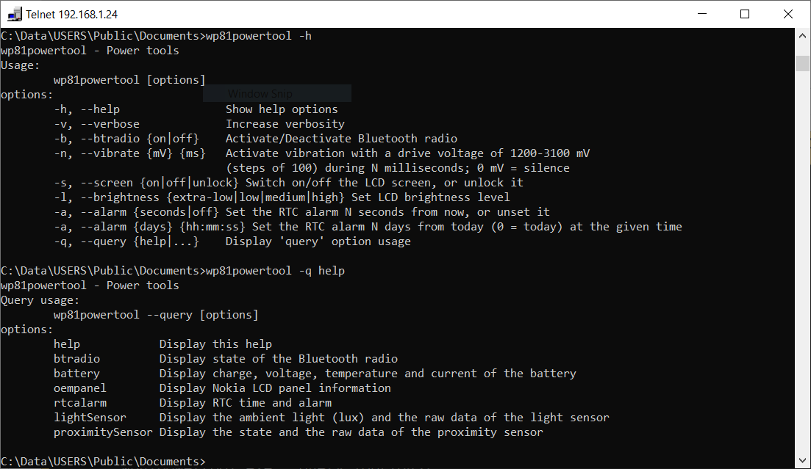
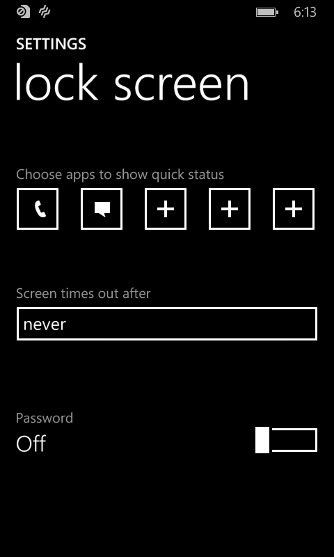
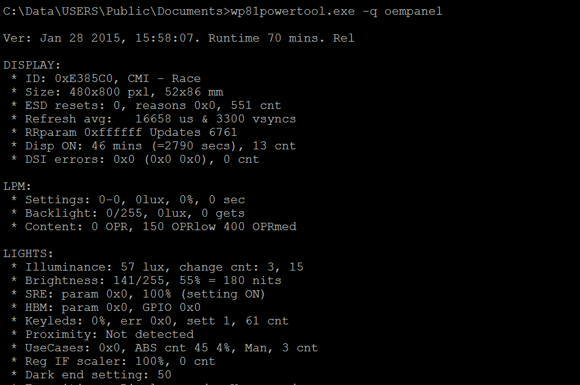

# Wp81Powertool

Adds some other usages compared to the existing powertool.exe of Windows Phone 8.1  
Use vscode+llvm+cmake to build the .exe  

## Usage



### Bluetooth

Leverages the COM BtConnectionManager interfaces to turn on/off the Bluetooth radio or query its current state.

### Vibration

Uses the IoctlCode IOCTL_PM_VIB_CONTROL_REGISTER of the Qualcomm PMIC driver (`\\.\QCOMPMIC`) to make your phone vibrate with a given drive voltage (1200-3100 mV, in steps of 100 mV) during a given number of milliseconds. A voltage of 0 keeps the motor off during the given duration (a silence).  
Example: `wp81powertool.exe --vibrate 2500 500`

### Battery

`--query battery` displays the remaining charge, the voltage, the temperature and the current of the battery.  
Example: `wp81powertool.exe --query battery`
```
Battery remaining charge: 85%
Battery voltage: 4071 mV
Battery temperature: 28.5 C
Battery current: -302 mA
```

| Value | Source |
|-------|--------|
| Remaining charge (%) | Windows Runtime "Windows.Phone.Devices.Power.Battery" interfaces |
| Voltage (mV) | IoctlCode IOCTL_BATTERY_QUERY_STATUS of the battery class driver [battc](https://github.com/fredericGette/Lumia520/blob/main/content/drivers/battc.md). The device is found through its interface `GUID_DEVICE_BATTERY` (`CM_Get_Device_Interface_ListW`). On the Lumia 520 the value is the `VBATT` ADC reading of [NokiaEnergyDriver](https://github.com/fredericGette/Lumia520/blob/main/content/drivers/nokiaenergydriver.md) |
| Temperature (°C) | IoctlCode IOCTL_BATTERY_QUERY_INFORMATION (level BatteryTemperature) of the same driver. NokiaEnergyDriver returns the `BATT_THERM` ADC reading in tenths of kelvin |
| Current (mA) | IoctlCode IOCTL_BMS_GET_BATTERY_CURRENT of the Qualcomm BMS driver "qcbms8930" (`\\.\QCOMPMICBMS`, see [qcbms8930](https://github.com/fredericGette/Lumia520/blob/main/content/drivers/qcbms8930.md)) |

A value that can't be read is reported as an error, without hiding the other values.  
With `--verbose`, the battery device path and tag, the power state (`ON_LINE`, `CHARGING`, `DISCHARGING`, `CRITICAL`), the rate reported by the battery class and the raw temperature are displayed too.

> [!NOTE]
> The current is the raw signed value of the BMS driver. Its sign convention (charge or discharge) hasn't been confirmed yet: compare it with the power state displayed by `--verbose --query battery`.

### Screen

Use some IoctlCodes of the "oempanel" driver.  
`--screen unlock` leverages the Windows Runtime "Windows.Phone.System.SystemProtection" interfaces to dismiss the lock screen (see [wp81daylimit](https://github.com/fredericGette/wp81daylimit)).

> [!NOTE]
> The on/off action doesn't work when the screen times out.  
> The app [WPTweaker](https://github.com/sensboston/WPTweaker) ([binary here](https://xdaforums.com/t/xap-source-wptweaker-registry-tweaker-for-wp8-1.3147272/)) can add a new entry "never" in the dropdown list in order to deactivate this timeout.  
> 

Example of result from the `--query oempanel`. This report is entirely generated by the "oempanel" driver.  


### RTC alarm

Use some IoctlCodes of the Qualcomm PMIC driver "qcpmic8930" (`\\.\QCOMPMIC`), see [wp81PmicTool](https://github.com/fredericGette/wp81PmicTool).  
`--alarm {seconds}` sets the alarm 0 of the PMIC RTC N seconds from now (`IOCTL_PM_RTC_ENABLE_ALARM`), `--alarm {days} {hh:mm:ss}` sets it N days from today (0 = today) at the given local time, `--alarm off` unsets it (`IOCTL_PM_RTC_DISABLE_ALARM`), and `--query rtcalarm` displays the RTC time, the alarm time and the alarm status.

### Light and proximity sensors

The ambient light sensor and the proximity sensor are the two functions of the Lite-On LTR-554ALS-02 chip ([ltr554als02](https://github.com/fredericGette/Lumia520/blob/main/content/drivers/ltr554als02.md)). Each one is a device of the sensor class extension [SensorsClx](https://github.com/fredericGette/Lumia520/blob/main/content/drivers/wpsensorsclx.md), found through its interface (`{97F115C8-599A-4153-8894-D2D12899918A}` for the light, `{5220DAE9-3179-4430-9F90-06266D2A34DE}` for the proximity). The tool starts a periodic notification (IoctlCodes 0x220014 / 0x220018), reads a sample with `ReadFile`, then stops the notification (0x22001C).

`--query lightSensor` displays the ambient light in lux, plus the raw data of the last sample (`IOCTL_SENSOR_OEM_CALIBRATION_QUERY`): the two photodiode channels, the gain, the integration time and the lux computed without calibration.  
Example: `wp81powertool.exe --query lightSensor`
```
Light sensor: 3.706 lux
Light sensor CH0 (visible + IR): 20
Light sensor CH1 (IR): 38
Light sensor gain: 96X
Light sensor integration time: 100 ms
Light sensor uncalibrated: 4.678 lux
```

`--query proximitySensor` displays `DETECTED` / `NOT DETECTED`, plus a raw reading of the chip (count 0-2047), the gain and the LED settings.  
Example: `wp81powertool.exe --query proximitySensor`
```
Proximity sensor: NOT DETECTED
Proximity sensor raw count: 348 (0-2047)
Proximity sensor gain: 16X
Proximity sensor LED: 5 pulses, 60 kHz, 100% duty cycle, 100 mA
```
With a finger on the sensor:
```
Proximity sensor: DETECTED
Proximity sensor raw count: 1949 (0-2047)
Proximity sensor gain: 16X
Proximity sensor LED: 5 pulses, 60 kHz, 100% duty cycle, 100 mA
```
The state changes when the raw count goes above 469 (far → near) or below 419 (near → far). These thresholds come from the calibration file `C:\DPP\Nokia\Sensors\PRX_LITEON_LTR554ALS02.bin`.

With `--verbose`, the manufacturer, model and PART_ID of the chip (`IOCTL_SENSOR_OEM_INFO_QUERY`), the device path, the capabilities of the sensor and each sample are displayed too.

### Accelerometer

The accelerometer is a Kionix KXTNK-1000 ([acckxtnk1000](https://github.com/fredericGette/Lumia520/blob/main/content/drivers/acckxtnk1000.md)), another client of [SensorsClx](https://github.com/fredericGette/Lumia520/blob/main/content/drivers/wpsensorsclx.md), found through its interface `{C2FB0F5F-E2D2-4C78-BCD0-352A9582819D}`. The tool reads it the same way as the light sensor (periodic notification, `ReadFile`, stop).

`--query accelerometer` displays the acceleration on the X, Y and Z axes in g, in the phone coordinate system: the offsets of the calibration are applied and the axes are rotated with the matrix of the ACPI method `ROTM`. A phone lying flat, screen up, gives about (0, 0, -1) g.  
It also displays the raw data of the last sample (`IOCTL_SENSOR_OEM_CALIBRATION_QUERY`): the values in the chip coordinate system, before the offsets and the rotation. On the Lumia 520, `ROTM` only inverts Z.  
Example: `wp81powertool.exe --query accelerometer`
```
Accelerometer X: 0.044 g
Accelerometer Y: 0.047 g
Accelerometer Z: -1.034 g
Accelerometer raw X: 0.032 g
Accelerometer raw Y: 0.040 g
Accelerometer raw Z: 1.032 g
```
With the phone turned so that the X axis (or the Y axis) points up, that axis shows ≈ +1 g and the other two ≈ 0.

> [!NOTE]
> The driver keeps sampling every 10 ms, so the raw values may come from a newer sample than the one displayed above them and differ slightly.
  
## Deployment

- [Install a telnet server on the phone](https://github.com/fredericGette/wp81documentation/tree/main/telnetOverUsb#readme), in order to run the application.  
- Manually copy the executable from the root of this GitHub repository to the shared folder of the phone.
> [!NOTE]
> When you connect your phone with a USB cable, this folder is visible in the Explorer of your computer. And in the phone, this folder is mounted in `C:\Data\USERS\Public\Documents`  
